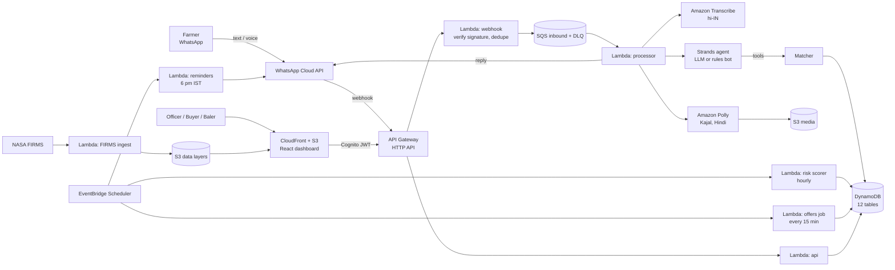

<p align="center"></p>

<h1 align="center">clearsky</h1>

<p align="center"><strong>Stop stubble fires before they start, by booking straw pickup over WhatsApp.</strong></p>

<p align="center">
  <a href="https://clearsky.akkki.tech">Live site</a> ·
  <a href="blog/clearsky-blog.md">Blog post</a> ·
  <a href="IMPLEMENTATION.md">Design</a> ·
  <a href="SETUP_GUIDE.md">Setup guide</a>
</p>


clearsky is a WhatsApp-first logistics system for paddy straw. A farmer sends one message or voice note in Hindi, Punjabi, Hinglish or English. An AI agent registers the field, books the nearest baler that can clear it before the wheat-sowing deadline, and routes the straw to the buyer who pays the most after transport. District officers get a Burn Risk Radar that flags fields likely to burn *before* a fire is lit.

Built by **Team Atherion** for the **WeMakeDevs x AWS Environmental Hacks** (Bharat Builds Tour, Event 02, 8–11 October 2026). Tracks: **Air** (stubble burning) and **Waste & Energy** (biomass).

> Others measure the smoke. We remove the reason to light the fire.

---

## Contents

1. [The problem](#1-the-problem)
2. [The solution](#2-the-solution)
3. [Users and interfaces](#3-users-and-interfaces)
4. [How a booking works](#4-how-a-booking-works)
5. [Features](#5-features)
6. [Architecture](#6-architecture)
7. [AWS services](#7-aws-services)
8. [Tech stack](#8-tech-stack)
9. [Repository structure](#9-repository-structure)
10. [Getting started](#10-getting-started)
11. [Configuration](#11-configuration)
12. [Deployment](#12-deployment)
13. [Impact and emission factors](#13-impact-and-emission-factors)
14. [Documentation](#14-documentation)
15. [Roadmap](#15-roadmap)
16. [Team](#16-team)
17. [Sources](#17-sources)

---

## 1. The problem

Every October and November, paddy stubble burning in Punjab and Haryana adds heavily to North India's smog.

- **The fires moved to the evening, not away.** Monitoring satellites pass over between about 10:30 am and 1:30 pm. In 2024 and 2025, over 90% of large farm fires in Punjab were lit after 3 pm, compared with 3% in 2021.
- **The burnt area is still large.** Official fire counts fell to 5,085 by late November 2025 (10,443 the year before), yet Punjab's burnt area was still about 20,000 km² in 2025, down from a peak of 31,447 km² in 2022.
- **The farmer's window is short.** Only a few weeks separate the paddy harvest from wheat sowing, and clearing straw costs time and money that a match does not.
- **The machines exist.** Punjab reports about 1,48,000 crop-residue-management machines and 1,331 custom hiring centres, but no shared schedule tells a baler which field is ready tomorrow.
- **The buyers exist.** About 11 lakh tonnes of paddy straw went into industrial boilers in 2023, and pellet plants keep opening. What they lack is steady supply.

Farmers, balers and buyers need each other and do not meet in time. This is a **logistics problem**, not an awareness problem.

## 2. The solution

clearsky connects the three groups at the moment it matters:

1. A farmer registers a field with **one WhatsApp message or voice note**. No app and no login.
2. The matcher **offers the booking to the best baler** with a free day before the sowing deadline. The farmer is told the booking is confirmed only after a baler accepts.
3. The straw is **routed to the buyer with the best net price** (price minus transport) and re-matched automatically when better demand appears.
4. Baler operators get a **mobile-first dashboard**: requests to accept, the day's stops on a map, and a Done button per field.
5. District officers get the **Burn Risk Radar**: every harvested but unbooked field is scored hourly, and one click alerts the whole village on WhatsApp.

## 3. Users and interfaces

| User | Interface | Does | Gets |
|---|---|---|---|
| Farmer | WhatsApp (text or voice) | Shares name, village, acres and harvest date; confirms harvest | A confirmed clearance date, an estimated payout and reminders |
| Baler operator | Web dashboard `/baler` (mobile-first) | Accepts or declines requests, sets capacity and availability, marks fields done | Full, clustered working days |
| Buyer | Web dashboard `/buyer` | Sets demand, price per tonne and pickup radius | Reliable straw supply and a delivery forecast |
| District officer | Web dashboard `/admin` | Monitors risk, alerts villages, approves new balers and buyers | Prevention before a fire, instead of a fine after it |

**Channel rule.** WhatsApp is used by farmers only. The agent collects the farmer's details, books through backend tools and replies in the farmer's language (with a voice reply when the farmer sent voice). Operators, buyers and officers use the dashboard and are never messaged on WhatsApp.

**Onboarding.** Balers and buyers register themselves through `/register`. An officer approves or rejects each application on `/admin/approvals`, and only then is a role granted. No user can assign themselves a role.

## 4. How a booking works


1. **Gurpreet** (8 acres, Bhawanigarh) sends a voice note: *"Mera 8 acre dhaan 24 tareekh ko katega."* ("My 8 acres of paddy will be harvested on the 24th.")
2. Amazon Transcribe converts the audio to text, and the agent extracts the name, village, acreage and harvest date, asking only for what is missing.
3. The matcher selects the best baler-day (distance, delay and a village-cluster bonus) and the best buyer (net price), and reserves all of it in **one DynamoDB transaction**.
4. The farmer is told the request has been sent to a baler. The baler sees it on the dashboard with a countdown.
5. When the baler **accepts**, the farmer receives the confirmed date and estimated payout. If the baler **declines** or does not answer within the SLA, the offer moves to the next-best baler. After three attempts, the field appears on the officer's radar as "no baler accepted".
6. A reminder goes out the day before. After baling, the operator taps **Done**, the farmer is notified, the straw is delivered, and the impact figures are recorded.


## 5. Features

**Farmer agent**
- WhatsApp text and voice in Hindi, Punjabi, Hinglish and English; Hindi voice replies through Amazon Polly.
- Built with the **Strands Agents SDK** and nine tools: find farmer, resolve village, register, add field, book, list bookings, confirm harvest, reschedule and cancel.
- Any LLM provider through `LLM_PROVIDER` (`openai` and OpenAI-compatible, `anthropic`, `gemini`, `bedrock`), plus a deterministic **rules bot** that works with no LLM and takes over if the LLM fails.
- Tools are bound to the verified sender's phone number, so the model can only act for the person who sent the message.

**Matching and bookings**
- Baler selection by distance, delay to the sowing deadline and village clustering, within each machine's daily capacity.
- Buyer selection by net price after transport (price minus a per-tonne-per-km cost), with automatic re-matching when a buyer is approved, changes demand, or a field is marked done. Delivered straw is never moved and the farmer's promised payout never changes.
- Double booking is prevented by DynamoDB transactions with conditional capacity checks.
- Baler offers with accept, decline, timeout and escalation.

**Burn Risk Radar**
- A risk score from 0 to 100 for each harvested but unbooked field, recalculated every hour:
  `100 x (0.45 x urgency + 0.25 x no_capacity + 0.30 x fire_history)`, scaled by 0.35 if the field is not yet harvested. Red at 60 and above, yellow at 40 and above.
- Fire history from NASA FIRMS (VIIRS) satellite detections, October to November 2022–2025.
- One-click village alerts that send every unbooked farmer in the village a pickup offer on WhatsApp.

**Dashboards**
- **Admin:** radar, fields, bookings, balers, buyers, approvals, impact, demo controls and a built-in WhatsApp farmer simulator.
- **Baler:** today's route on a map, requests, schedule, history and profile (capacity and availability).
- **Buyer:** overview, demand and price, deliveries and profile.
- **Public:** home page at `/` and an impact page at `/impact`.

**Operations**
- Reminders at 6 pm India time, offer expiry checks every 15 minutes, risk scoring every hour.
- A dead-letter queue and CloudWatch alarms with email notification through SNS.
- A demo mode with a simulated clock to replay a season in minutes.

## 6. Architecture

The backend is fully serverless: between two messages nothing runs and nothing is billed.




**Request path for one WhatsApp message.** The webhook Lambda verifies Meta's signature, drops duplicates and queues the message, then returns immediately, because WhatsApp expects a fast response and a voice note can take several seconds to process. The processor Lambda handles transcription, the agent, booking and the reply. A message that fails three times is moved to the dead-letter queue and raises an alarm.

Full design, data model and algorithms: [`IMPLEMENTATION.md`](IMPLEMENTATION.md).

## 7. AWS services

### Deployed services

| Service | Use |
|---|---|
| **AWS Lambda** | Eight functions (Python 3.12, arm64): webhook, processor, API, risk scorer, offers job, reminders, FIRMS ingest and health |
| **Amazon API Gateway (HTTP API)** | WhatsApp webhook and dashboard REST API, with a Cognito JWT authorizer |
| **Amazon SQS** | Inbound message queue with a dead-letter queue, decoupling the webhook from slow processing |
| **Amazon DynamoDB** | Twelve on-demand tables; transactions prevent double booking |
| **Amazon Cognito** | Sign-in for officers, buyers and operators, with role groups and self sign-up for applicants |
| **Amazon Transcribe** | Hindi (hi-IN) speech-to-text for voice notes, directly from the WhatsApp audio file |
| **Amazon Polly** | Hindi voice replies with the neural voice Kajal |
| **Amazon EventBridge Scheduler** | Hourly risk scoring, 15-minute offer expiry and daily 6 pm reminders (Asia/Kolkata) |
| **Amazon S3** | Voice media (deleted after seven days), FIRMS fire layers and the dashboard build |
| **Amazon CloudFront** + **AWS Certificate Manager** | Dashboard hosting on the custom domain over HTTPS |
| **AWS Systems Manager Parameter Store** | WhatsApp, LLM and FIRMS secrets as SecureString parameters |
| **Amazon CloudWatch** + **Amazon SNS** | Logs, alarms on errors and the dead-letter queue, email alerts |
| **AWS IAM (OIDC)** | GitHub Actions deploys through a role with no stored AWS keys |
| **Amazon Bedrock** (optional) | LLM for the farmer agent when `LLM_PROVIDER=bedrock` |

### AWS open-source tools

| Tool | Use |
|---|---|
| **Strands Agents SDK** | The farmer conversation agent and its nine tools |
| **AWS SAM** | Infrastructure as code (`infra/template.yaml`), builds and deploys |
| **Powertools for AWS Lambda (Python)** | Structured logging and API event handling |

## 8. Tech stack

| Layer | Technology |
|---|---|
| Backend | Python 3.12, Strands Agents SDK, boto3, Powertools for AWS Lambda, Pydantic v2, rapidfuzz, httpx; managed with uv |
| Infrastructure | AWS SAM (`infra/template.yaml`, `infra/web.yaml`, `infra/ci.yaml`), arm64 Lambda with a dependency layer |
| Frontend | React 19, Vite, TypeScript, Tailwind CSS v4, MapLibre GL, Recharts, TanStack Query, AWS Amplify Auth, Lenis |
| Data | NASA FIRMS (VIIRS) fire detections; seeded demo data for one district |
| Testing | pytest with moto (backend), Vitest (dashboard), Playwright (end-to-end) |
| CI/CD | GitHub Actions with AWS OIDC |
| Media | Remotion (explainer animations), Playwright screen recordings, Excalidraw diagrams |

## 9. Repository structure

Everything lives in one repository. The root `Makefile` (or `make.ps1` on Windows) drives the backend and infrastructure; the dashboard has its own `npm` scripts.

```
clearsky/
├── README.md               Project overview (this file)
├── CONTEXT.md              Living project context, updated after every change
├── IMPLEMENTATION.md       Architecture, flows, data model, algorithms
├── PLAN.md                 Phase-wise build plan
├── PROGRESS.md             Per-phase log
├── SETUP_GUIDE.md          Step-by-step setup for AWS, WhatsApp, FIRMS and GitHub
├── CLAUDE.md, AGENTS.md    Rules for AI coding assistants
├── Makefile, make.ps1      Root commands (macOS/Linux and Windows)
├── .github/workflows/      Test and deploy pipeline
├── infra/                  SAM templates: backend, web hosting, CI role
├── backend/
│   ├── src/clearsky/
│   │   ├── agent/          Farmer agent, tools, prompts, memory, rules bot
│   │   ├── channels/       WhatsApp, voice, message templates, notifications
│   │   ├── domain/         Matching, offers, pricing, risk, alerts, impact, registration
│   │   ├── handlers/       Lambda entry points
│   │   ├── models/         Pydantic models
│   │   ├── repo/           DynamoDB repositories
│   │   └── seed/           Demo data generation and loading
│   ├── scripts/            Dev server, chat CLI, seeding, FIRMS fetch, AWS checks
│   └── tests/
├── dashboard/              React app: home, admin, baler, buyer, impact
├── data/                   Seed data and map layers
├── docs/                   Design system, runbook, templates, video script, submission
├── blog/                   Blog post, images and editable Excalidraw diagrams
├── video/                  Remotion project and screen-recording scripts
└── scripts/                Secrets and GitHub helper scripts
```

## 10. Getting started

### Prerequisites

- [uv](https://docs.astral.sh/uv/) (installs Python 3.12 for the project) and Node.js 20 or later
- For deployment only: an AWS account with the AWS CLI configured, the AWS SAM CLI, a Meta developer account with a WhatsApp Cloud API number, and a NASA FIRMS map key

Every command is available as `make <target>` on macOS and Linux and as `.\make.ps1 <target>` on Windows.

### Run the whole system locally (no AWS, no keys)

```bash
git clone https://github.com/sanskarjoshiii/clearsky.git
cd clearsky
cp .env.example .env      # never commit .env

make install              # Python environment in backend/.venv
make dev                  # terminal 1: API on :8787 with a mock database, seed data and WhatsApp simulator
make dashboard            # terminal 2: dashboard on http://localhost:5173
```

Local sign-in uses the dev login: `/admin/login`, `/baler/login` and `/buyer/login`. The farmer side runs through the WhatsApp simulator docked in the admin dashboard, or in the terminal with `make chat`.

### Quality checks

```bash
make lint                 # ruff and mypy
make test                 # pytest (no AWS needed)
make e2e                  # Playwright smoke tests of the full loop
cd dashboard && npm run typecheck && npx vitest run
```

### Other targets

| Target | Purpose |
|---|---|
| `make chat` | Farmer agent in the terminal (rules bot, or the LLM configured in `.env`) |
| `make book-all` | Matcher dry run over the seed data |
| `make gen-seed` / `make seed` | Generate seed data / load it into the deployed tables (replaces existing items) |
| `make firms` | Fetch NASA FIRMS fire history |
| `make check-aws` | Read-only readiness check of the AWS account |
| `make dev-cloud` | Local API with real WhatsApp (tunnel the webhook with ngrok) |
| `make validate` / `make build` | Validate and build the SAM application |

## 11. Configuration

Configuration is read from environment variables locally and from SSM Parameter Store when deployed. Secrets are never committed.

| Variable | Purpose |
|---|---|
| `AWS_REGION` | Deployment region (`ap-south-1`) |
| `LLM_PROVIDER` | `rules`, `openai`, `anthropic`, `gemini` or `bedrock` |
| `WA_PHONE_NUMBER_ID`, `WA_ACCESS_TOKEN` | WhatsApp sender and Graph API token (SSM) |
| `WA_APP_SECRET`, `WA_VERIFY_TOKEN` | Webhook signature check and verification (SSM) |
| `FIRMS_MAP_KEY` | NASA FIRMS access (SSM) |
| `TRANSCRIBE_LANGUAGE` | Voice language, `hi-IN` |
| `POLLY_VOICE` | Voice reply, `Kajal` |
| `TONNES_PER_ACRE` | Straw yield estimate |
| `SOWING_WINDOW_DAYS`, `SEASON_SOWING_CUTOFF` | Harvest-to-sowing window and the season's hard cutoff |
| `OFFER_SLA_MINUTES`, `OFFER_MAX_ATTEMPTS` | Baler response time and number of balers tried |
| `EMISSION_FACTORS` | Sourced emission factors for the impact calculation (see section 13) |
| `DEMO_MODE` | Enables the simulated clock |

Full list: [`IMPLEMENTATION.md`](IMPLEMENTATION.md) section 13 and `.env.example`.

## 12. Deployment

Every push to `main` runs the GitHub Actions pipeline in [`.github/workflows/deploy.yml`](.github/workflows/deploy.yml):

1. **Test:** backend lint, type checks and tests; dashboard type check and tests.
2. **Deploy:** the SAM backend stack, then the dashboard build to S3 with a CloudFront invalidation.

AWS access uses GitHub OIDC and the IAM role defined in [`infra/ci.yaml`](infra/ci.yaml), so no AWS keys are stored in GitHub. Application secrets stay in SSM Parameter Store and are never touched by the pipeline.

Manual deployment requires team approval and is guarded:

```bash
make validate
make deploy CONFIRM=yes          # Windows: .\make.ps1 deploy -Confirm yes
```

### Connecting WhatsApp

1. In the Meta app, set the webhook URL to `<ApiUrl>/webhook/whatsapp` with the verify token from SSM.
2. Subscribe to the `messages` field.
3. Add test recipients (these act as demo farmers).
4. Create the message templates `pickup_reminder` and `village_alert`, required for messages outside the 24-hour window. Template text: [`docs/whatsapp_templates.md`](docs/whatsapp_templates.md).

## 13. Impact and emission factors

When a baler marks a field done, clearsky records the straw that was not burnt and, if configured, the pollution avoided:

```
pollution avoided (kg) = straw not burnt (tonnes) x emission factor (kg per tonne burnt)
```

**No emission factor is hard-coded.** Each factor in `EMISSION_FACTORS` must carry its source citation; a factor without a source is ignored, and until one is set, the dashboards show no pollution figures. Impact is shown on the admin Impact page and the public `/impact` page.

When the team agrees on factors, record them here and have a second teammate check each value against the paper:

| Pollutant | Value (kg per tonne of rice straw burnt in the open) | Source (author, year, journal, table or page) | Link | Checked by |
|---|---|---|---|---|
| PM2.5 | Not set | | | |
| PM10, CO, CO₂, black carbon | Not set | | | |

## 14. Documentation

| Document | Contents |
|---|---|
| [`CONTEXT.md`](CONTEXT.md) | Current state, decisions, open questions and changelog |
| [`IMPLEMENTATION.md`](IMPLEMENTATION.md) | Design source of truth: architecture, data model, algorithms |
| [`PLAN.md`](PLAN.md) / [`PROGRESS.md`](PROGRESS.md) | Build plan and per-phase progress |
| [`SETUP_GUIDE.md`](SETUP_GUIDE.md) | Account, key and service setup |
| [`docs/demo_runbook.md`](docs/demo_runbook.md) | Live demo runbook |
| [`docs/design-system.md`](docs/design-system.md) | Dashboard design system |
| [`blog/clearsky-blog.md`](blog/clearsky-blog.md) | Project write-up with diagrams |

## 15. Roadmap

- Punjabi voice replies when a suitable text-to-speech voice is available
- Satellite harvest detection with Sentinel-2 (NDVI) and Sentinel-1 radar for hazy days
- UPI payouts to farmers and formal buyer contracts
- Integration with state and CAQM data; multi-district rollout
- Support for the wheat-residue season

## 16. Team

**Team Atherion**

| Member | Contribution |
|---|---|
| Sanskar Joshi | Core system, WhatsApp agent and deployment |
| Kamran Pathan | Dashboards and AWS backend |
| Akshay | AI model and pollution impact view |
| Anushka | Emission factor method and approvals |

## 17. Sources

- Fire timing, satellite pass times and burnt area: iFOREST *Stubble Burning Status Report 2025*, via The Tribune, 9 December 2025. https://www.tribuneindia.com/news/delhi/satellites-miss-majority-of-stubble-fires-delhi-air-pollution-underestimated-report
- 2025 fire count and crop-residue machines: The Tribune, 25 November 2025. https://www.tribuneindia.com/news/punjab/farm-fires-down-to-50-as-season-nears-end
- Custom hiring centres: PTI via The Week, 20 April 2025. https://www.theweek.in/wire-updates/national/2025/04/20/des20-pb-stubble-plan.amp.html
- Straw used in industrial boilers and pellet plants: The Tribune, 17 September 2024. https://www.tribuneindia.com/news/punjab/to-counter-stubble-burning-punjab-govt-pushes-green-fuel-initiative
- Fire history: NASA FIRMS (VIIRS), October to November 2022–2025.

Screenshots and seed data are synthetic demo data; no real farmer data is included in this repository.

## License

MIT
