# The fire starts at 5 pm. The satellite left at 1:30.

*How we built clearsky: one WhatsApp voice note books a baler for a paddy field, before anyone strikes a match. Four days, four people, fully serverless on AWS.*

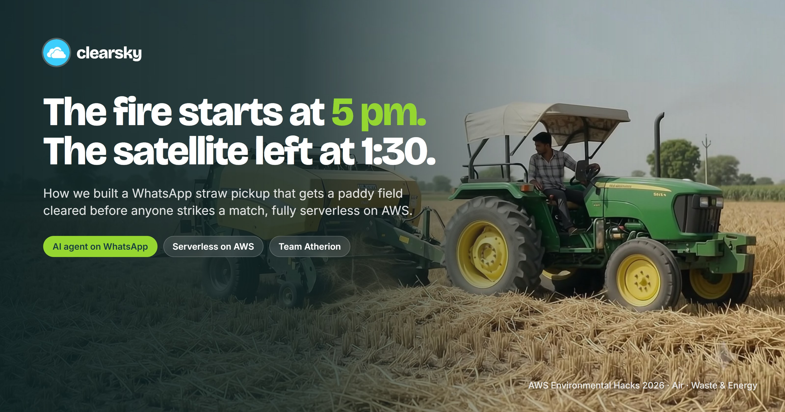

> **In one minute**
> - Punjab's farmers burn paddy straw because clearing it in time is hard, not because they want to.
> - **clearsky** turns one WhatsApp message (typed or spoken, in Hindi, Punjabi, Hinglish or English) into a booked baler and a buyer for the straw.
> - District officers get a **Burn Risk Radar** that warns a village *before* the match, not a fine after the smoke.
> - It runs fully serverless on AWS: Lambda, API Gateway, SQS, DynamoDB, Cognito, Transcribe, Polly, EventBridge Scheduler, S3 and CloudFront.
> - Live at **clearsky.akkki.tech** · Built by Team Atherion for the WeMakeDevs × AWS Environmental Hacks (Air, and Waste & Energy).

---

## Our first version lied to a farmer

He was a test farmer, thankfully. Gurpreet sent one message: eight acres of paddy, harvest on the 24th, village Bhawanigarh. Seconds later the bot replied in his own Hinglish: *"✅ Gurpreet ji, your field will be cleared on the 25th."*

Every test was green. The booking was in the database. The baler's day had the acres reserved.

**Nobody had asked the baler.**

Put a real farmer there, and a baler whose machine is broken that week. The farmer waits on a promise made of nothing, the sowing deadline arrives, and the field burns. We had built a faster way to cause the exact thing we were trying to stop.

That bug shaped everything that follows. But first, the satellite.

## The problem is not the fire

Every October, paddy stubble burning in Punjab and Haryana adds heavily to North India's smog. The official response has been to count fires from orbit and fine the farmers underneath them.

The satellites that count them pass over between **10:30 am and 1:30 pm**. In 2024 and 2025, **over 90% of the large farm fires in Punjab were lit after 3 pm**. In 2021, that share was 3%.

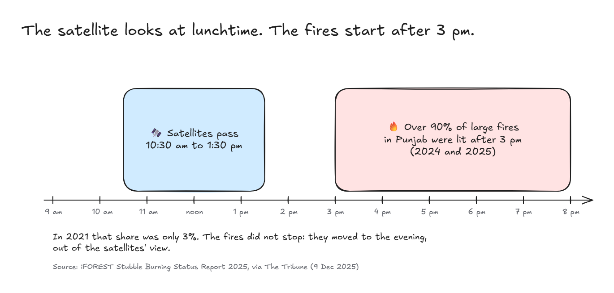

The fires did not go away. They moved to tea time. Official fire counts fell steeply (5,085 cases by late November 2025, against 10,443 the year before), yet Punjab's burnt area was still about **20,000 km² in 2025**, down from a peak of 31,447 km² in 2022.

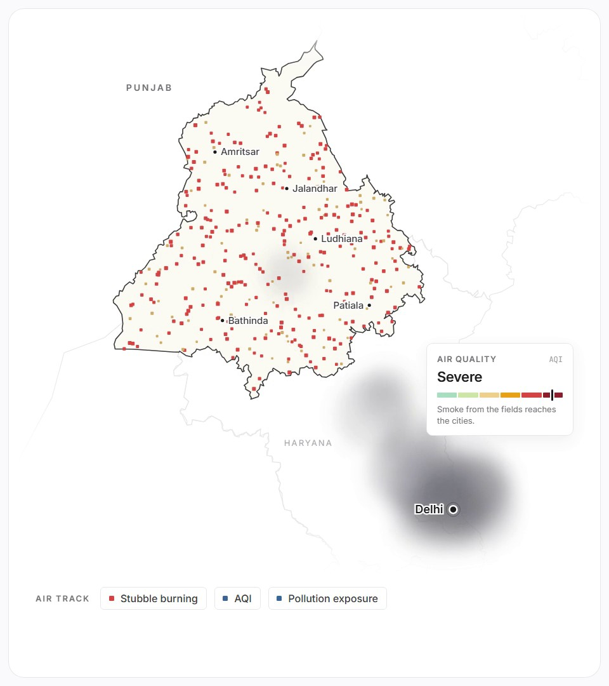

So we decided **not** to build a better fire detector. We asked a simpler question: *why does a farmer light the field at all?*

## It is a logistics problem

After harvesting rice, a farmer has only a few weeks to sow wheat. The straw is in the way. Clearing it costs time and money; a match costs nothing and takes an evening.

The other two people in this story are stuck too:

- **The machines exist.** Punjab reports **1,48,000 crop-residue machines** in use and **1,331 custom hiring centres** that rent them out. But there is no shared schedule telling a baler which field is ready tomorrow, two villages away.
- **The buyers exist.** In 2023 about **11 lakh tonnes** of paddy straw went into industrial boilers, and pellet plants keep opening (16 running in 2024, with 21 more on the way). What they lack is *steady* supply.

Three groups who need each other, and never meet in time.

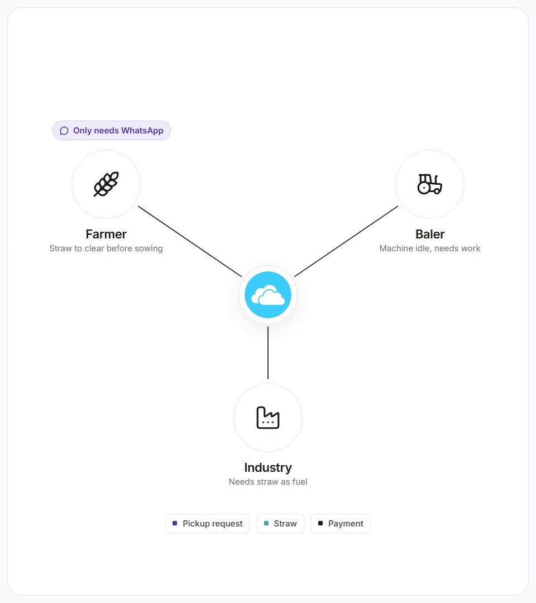

That is the whole idea: **others measure the smoke; we remove the reason to light the fire.**

## One voice note, start to finish

The farmer installs nothing and logs into nothing. He sends a WhatsApp message or a voice note. That is his entire interface.

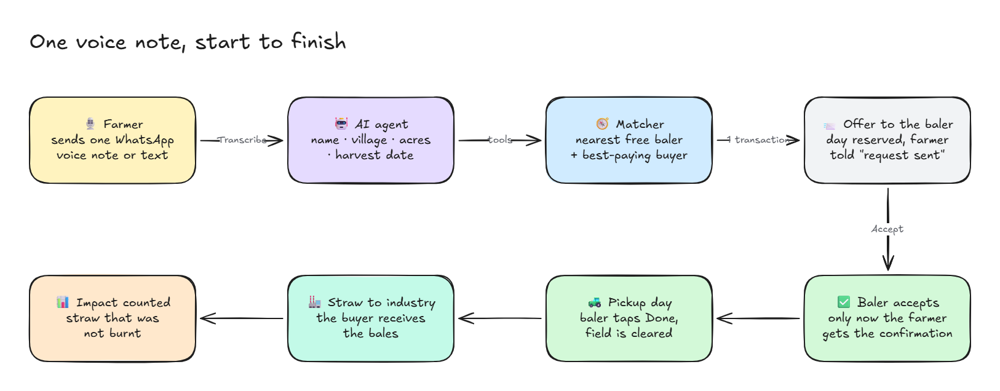

1. An **AI agent** (built with the Strands Agents SDK) pulls out the name, village, acres and harvest date, and asks only for what is missing.
2. A **matcher** finds the nearest baler with a free day before the sowing deadline, and the **buyer who pays best after transport**.
3. Everything is reserved in **one database transaction**, so two farmers can never get the same baler-day.
4. The farmer gets a date and an estimated payout. The baler gets a stop. The buyer gets a forecast.

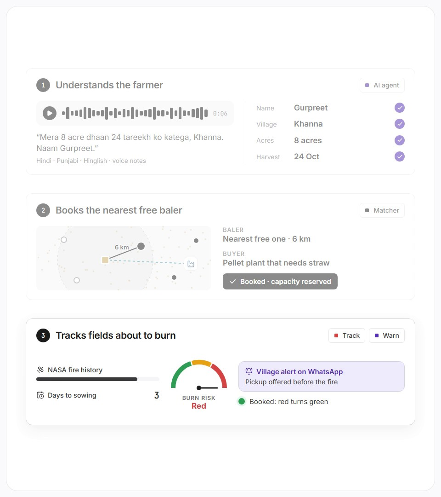

Farmers only ever use WhatsApp. Everyone else gets a web app of their own: the district officer, the baler and the buyer, each with a separate sign-in.

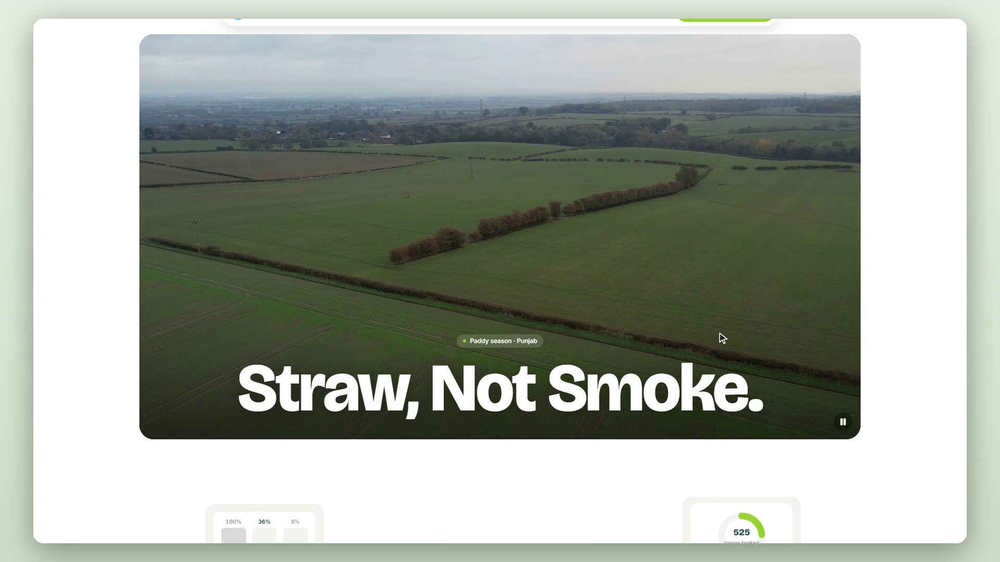

## The promise we had to stop making

Back to the lie. Booking instantly looked great in a demo. But a real baler must be able to say no: the machine is broken, the field is too far, the day is full. **A system that cannot hear "no" will keep telling farmers "yes".**

So a booking became a question.

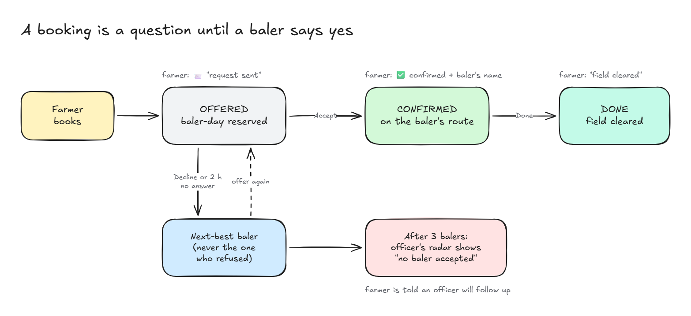

- A new booking is an **offer** to the best baler. His day is reserved at once, but the farmer only hears *"📨 your request has been sent to a baler"*.
- The baler sees it on his phone with a countdown. **Accept**, and only then does the farmer get the ✅ with the baler's name.
- **Decline**, or no answer in two hours, and it moves to the next-best baler. The one who refused is never asked again for that field.
- After three balers, the field lands on the officer's radar as *"no baler accepted"*, and the farmer is told an officer will follow up.

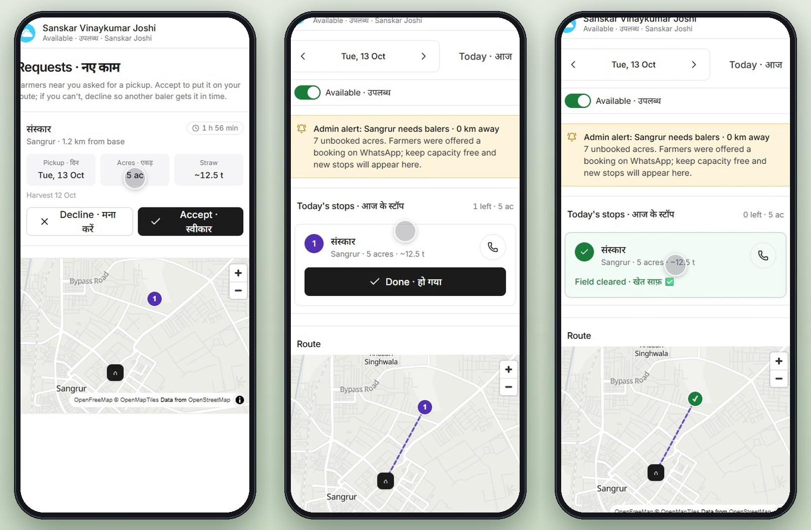

The ✅ emoji is now reserved for one event: a human said yes. This removed our prettiest demo moment. We would make the same trade again.

## Seeing the fire before it starts

The officer's main screen is the **Burn Risk Radar**. Every field that is harvested but not booked gets a score from 0 to 100, recalculated every hour:

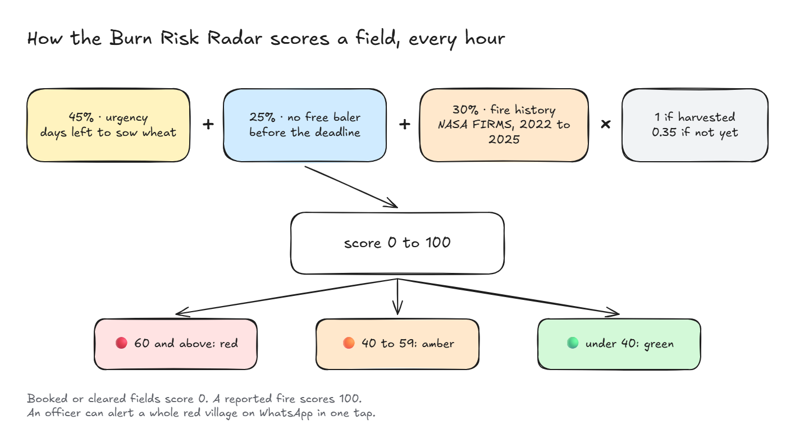

Fire history comes from **NASA FIRMS** satellite data: 19,926 fire points from October and November of 2022 to 2025, counted around each village. Red means *"this field is likely to burn soon."* The officer taps **Alert**, and every farmer in that village with an unbooked field gets a one-tap pickup offer on WhatsApp.

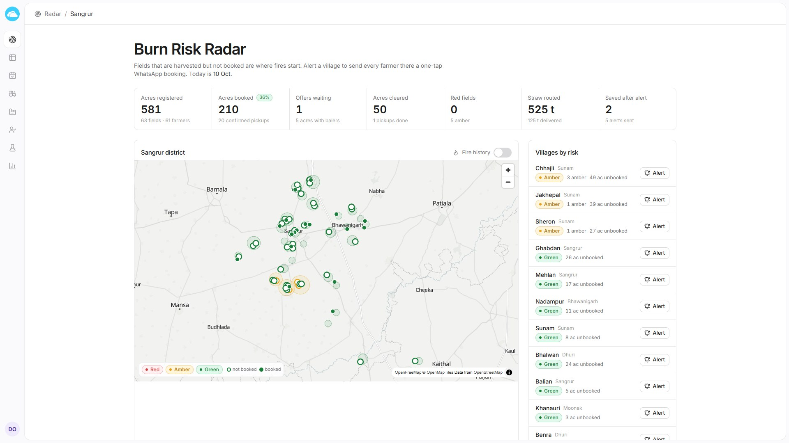

A fine arrives after the smoke. **An alert arrives before the match.**

## Straw goes to whoever pays best

The straw does not vanish: it becomes pellets, boiler fuel or compressed biogas. Buyers set their own demand, price and pickup radius, and see every tonne heading their way.

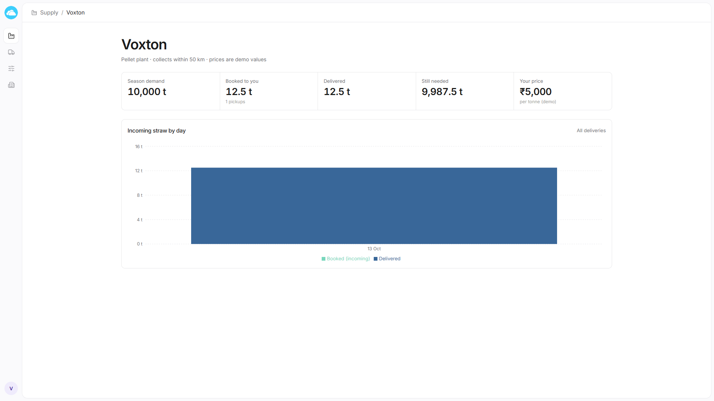

The matcher always sends straw to the buyer with the best price *after* transport. When a new buyer is approved, or a buyer raises its price, open bookings are re-checked automatically, and once more when the baler taps **Done**. Delivered straw never moves, and the farmer's promised payout never changes.

New balers and buyers register themselves; the officer approves them, and only then do they get a role. Nobody can make themselves an admin.

## How this actually cleans the air

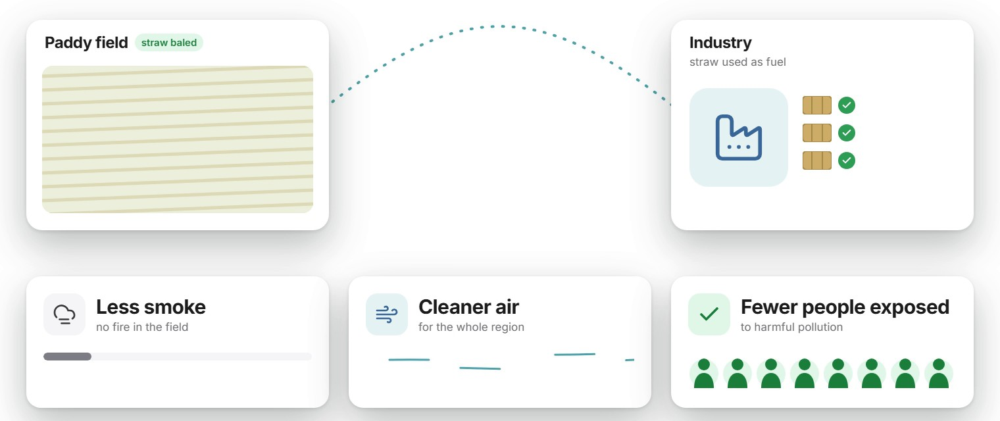

Our claim is simple, and we want to be careful about how far it goes: **straw that is baled is straw that is not burnt.** Every field cleared before the deadline is PM2.5, carbon monoxide and soot that never enters the evening air, on exactly the days the AQI is worst.

When the baler taps Done, the app works out:

```
pollution avoided (kg) = straw not burnt (tonnes) × emission factor (kg per tonne burnt)
```

Here is the part we are proudest of: **there is no emission factor in our code.** It would have taken thirty seconds to paste in a number that looked right. Instead, the factor is a setting that must come from a published paper, **with its citation**. A factor without a source is ignored, and until one is set, the app shows no pollution number at all.

A project about air quality that invents its air-quality numbers has already lost the argument.

What we can claim: the mechanism is real, and the booking loop works end to end on a live AWS stack. What we cannot claim yet: a measured drop in anyone's AQI. That needs a season in a real district.

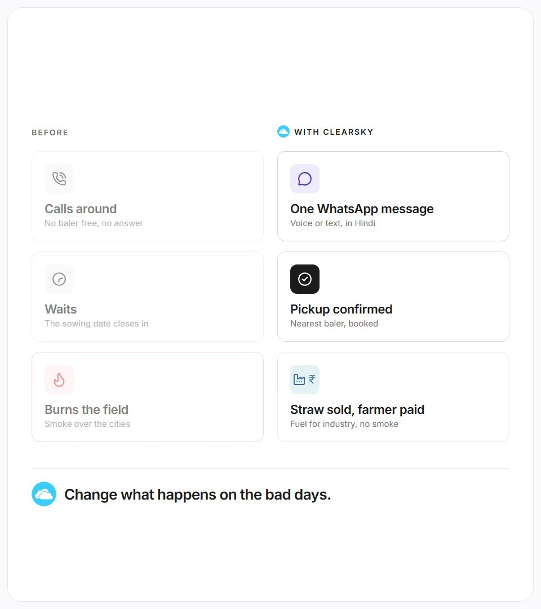

## Built on AWS: fully serverless

Between two messages, nothing runs and nothing is billed.

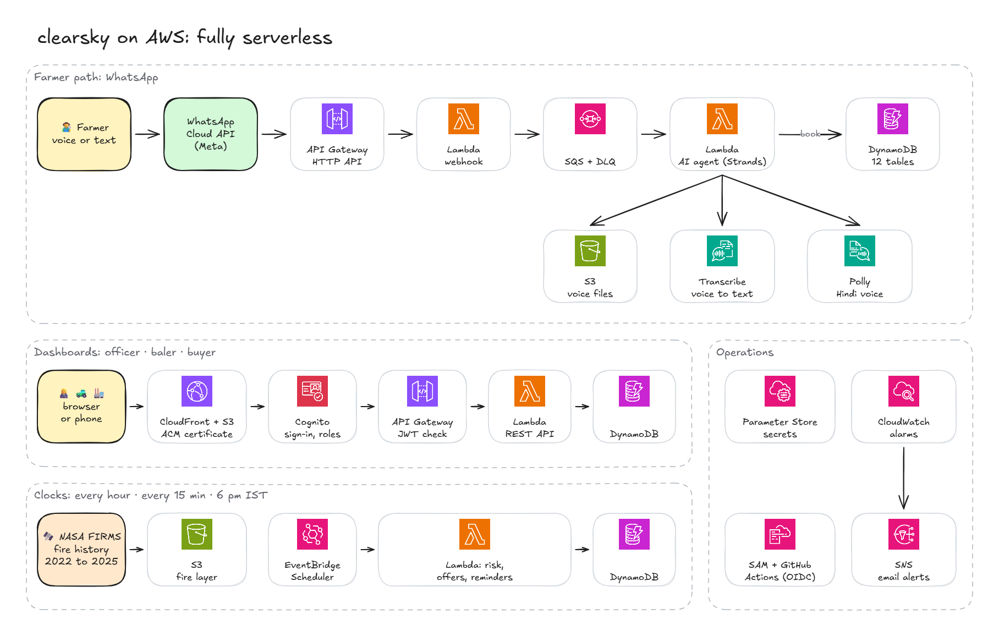

- **Amazon API Gateway (HTTP API)** receives WhatsApp's webhook and serves the dashboard API, with a **Cognito** JWT check in front.
- **AWS Lambda** (8 functions, Python 3.12, arm64) does all the computing. The webhook has one job: verify Meta's signature, drop duplicates, and queue the message.
- **Amazon SQS** sits in between, because WhatsApp wants an answer in a moment and a voice note can take far longer. A message that fails three times goes to a dead-letter queue and a **CloudWatch** alarm emails us through **SNS**.
- **Amazon Transcribe** (hi-IN) turns the voice note into words, straight from the WhatsApp audio file, with no conversion. While it works, the farmer sees *"🎙️ Sun raha hoon…"* (I'm listening).
- **Amazon Polly** answers back in Hindi with the neural voice **Kajal**, so a farmer who would rather talk than type never has to read a word.
- **Amazon DynamoDB** holds everything in 12 on-demand tables. A booking is one transaction:

```python
# simplified from backend/src/clearsky/domain/matching.py
tx.update("BalerDays", ..., condition="booked_acres <= :cap_minus_a")  # baler has room that day
tx.put("Bookings", booking, condition="attribute_not_exists(booking_id)")
tx.update("Fields", ..., condition="#s IN (:registered, :harvested)")   # field not booked twice
tx.update("Buyers", ..., condition="reserved_tonnes <= :max_reserved")  # buyer has room
tx.execute()  # all four happen, or none do
```

- **Amazon EventBridge Scheduler** keeps three clocks: risk every hour, unanswered offers every 15 minutes, and reminders at **6 pm India time**.
- **Amazon S3 + CloudFront** store voice files (deleted after seven days) and the satellite fire layer, and serve the dashboard on our own domain.
- Around it: **AWS SAM** describes the whole stack in one template, secrets live in **SSM Parameter Store**, and **GitHub Actions** deploys every push to `main` through **OIDC**, so no AWS key is stored anywhere.

The agent itself runs on **Strands Agents** with nine tools (find the farmer, resolve a village, register, add a field, book, list bookings, confirm a harvest, reschedule, cancel). The farmer's phone number is not something the model can type: each tool is built for the one person who sent the message, so a confused model can still only act for that person.

## What fought back

- **A presigned URL that only worked after a redirect.** S3 links signed against the global endpoint got a 307 for our Mumbai bucket, which broke the browser's CORS check. The fire map and Polly's voice replies failed until we signed against the regional endpoint.
- **A preflight that hit the bouncer.** With a Cognito JWT authorizer on our catch-all API route, the browser's CORS preflight got a 401. It needed its own route with no authorizer.
- **A deploy that could not prove who it was.** Our first GitHub OIDC deploy failed because GitHub's token subject format had changed, and IAM only said "not authorized".
- **The temptation to guess** the emission factor. The hardest thing that fought back was not technical.

## Three things we would tell ourselves on day one

1. **Find the sentence your product is not allowed to say.** Ours was "your field will be cleared", before a human had agreed to clear it.
2. **A demo that cannot fail is hiding something.** Instant booking never failed. That was the problem.
3. **If a number matters, make it impossible to fake.** Not by promising to be careful, but by writing code that ignores a number without a source.

The satellite will keep looking away at 1:30. That is fine. By 5 pm, we want there to be nothing left to burn.

---

**Try it**
- Live: https://clearsky.akkki.tech
- Code: https://github.com/sanskarjoshiii/clearsky
- Demo video: *(link)*

Built by **Team Atherion**: Sanskar Joshi, Kamran Pathan, Akshay and Anushka, for the WeMakeDevs × AWS Environmental Hacks, 8–11 October 2026.

**Sources**
- Fire timing, satellite pass times and burnt area: iFOREST *Stubble Burning Status Report 2025*, via The Tribune, 9 Dec 2025. https://www.tribuneindia.com/news/delhi/satellites-miss-majority-of-stubble-fires-delhi-air-pollution-underestimated-report
- 2025 fire count and 1,48,000 machines: The Tribune, 25 Nov 2025. https://www.tribuneindia.com/news/punjab/farm-fires-down-to-50-as-season-nears-end
- 1,331 custom hiring centres: PTI via The Week, 20 Apr 2025. https://www.theweek.in/wire-updates/national/2025/04/20/des20-pb-stubble-plan.amp.html
- Straw in boilers (2023) and pellet plants: The Tribune, 17 Sep 2024. https://www.tribuneindia.com/news/punjab/to-counter-stubble-burning-punjab-govt-pushes-green-fuel-initiative
- Fire history on the radar: NASA FIRMS (VIIRS), October–November 2022 to 2025.

*Screenshots show demo data and demo prices; no real farmer data appears in this post. Diagrams were drawn in Excalidraw; editable sources are in `blog/diagrams/`.*
